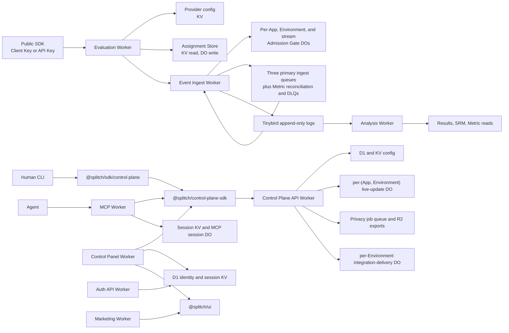

# System architecture: Worker boundaries

Status: implemented Worker boundaries; Web Event intake remains planned.
Vocabulary: domain terms follow [CONTEXT.md](../../CONTEXT.md). This page is the map for physical
deploy units and import boundaries. The detailed build layout lives in
[monorepo-and-toolchain.md](../spec/platform/monorepo-and-toolchain.md).

## Architecture rule

splitch uses capability Workers. A Worker is a trust boundary, not a foldering preference.

Do not collapse MCP, Evaluation, Event Ingest, Analysis, Auth API, or Control Plane API into a
generic `api` or `edge` Worker. Shared code moves into `packages/` only when it passes the deletion
test. Worker-specific bindings and orchestration stay inside the owning Worker.

The diagram shows the accepted architecture. Queue-backed admission and delivery are implemented for
`raw_events`, `raw_evaluations`, and Metric Events. Web Event intake remains the unimplemented part of
the target.



## Worker boundaries

| Worker                   | Trust boundary               | Owns                                                                                                                                                                                                                                 | Must not own                                                               |
| ------------------------ | ---------------------------- | ------------------------------------------------------------------------------------------------------------------------------------------------------------------------------------------------------------------------------------ | -------------------------------------------------------------------------- |
| Control Plane API Worker | Authenticated management API | Privacy jobs/exports, integration delivery, Organization, App, Environment, Flag definition, Flag Configuration, Promotion, Experiment, Run, Event Definition, Metric, Segment, Client Key, API Key, generated OpenAPI               | MCP transport, public SDK evaluate, event ingest, Tinybird result reads    |
| MCP Worker               | Agent protocol adapter       | Remote MCP OAuth PRM/auth.md handshake, tool registry, schema derivation, session KV, MCP session DO, calls through `@splitch/control-plane-sdk`                                                                                     | D1/Tinybird access, domain invariants, direct Worker imports               |
| Evaluation Worker        | Data-plane resolution        | Public Client Key evaluate, API-Key-only peek (ADR-0034), control-plane dry-run test-eval, OFREP, Precomputed Evaluations, Exposure Ticket redemption, Provider reads, Assignment Store reads/writes, Exposure creation              | Config mutation, Tinybird result reads, Metric/statistical calculation     |
| Event Ingest Worker      | Append-only intake           | Evaluation usage, Exposure, Activation, and Metric Event validation; planned Web Event intake; Event Definition version stamping; per-scope Admission Gate DOs; queueing; sharded Durable Object dedup and outbox; Tinybird delivery | Variant resolution, Run lifecycle, results calculation, control-plane CRUD |
| Analysis Worker          | Results read model           | Tinybird proxy reads, Web Analytics, SRM, Metric and statistical result contracts, `app_id` and `environment_id` injection from auth/path context                                                                                    | SDK evaluate, event ingest, config mutation                                |
| Auth API Worker          | Identity and token surface   | OAuth metadata, ID-JAG/device/anonymous doors, token issuance, token revocation, provisional create handoff                                                                                                                          | Post-create Organization/App management, SDK credentials, analytics        |
| Control Panel Worker     | Authenticated UI             | SSR routes, KV sessions, D1 membership/navigation reads, TanStack Query cache, live-update socket lifecycle                                                                                                                          | Management invariants, direct Worker code imports                          |
| Marketing Worker         | Public UI                    | Static/prerendered marketing surface, shared design system usage                                                                                                                                                                     | Authenticated App data, control-plane SDK transport, Worker bindings       |

## Checked-in runtime bindings

All eight `apps/*/wrangler.jsonc` files define local, shared-preview, and production targets.
Binding names below are stable across those targets; resource IDs and remote script names vary.
Cross-script DO bindings refer to the owning Worker, not a second copy of its storage.

| Worker            | Storage and coordination bindings                                                                                                                                                                                                                                                                                                                       | Service bindings                                                                       |
| ----------------- | ------------------------------------------------------------------------------------------------------------------------------------------------------------------------------------------------------------------------------------------------------------------------------------------------------------------------------------------------------- | -------------------------------------------------------------------------------------- |
| Control Plane API | D1 `DB`; KV `SESSION_STORE`, `CONFIG_STORE`, `CREDENTIAL_STORE`; DOs `CONFIG_STORE_WRITER`, `INTEGRATION_DELIVERY`, `CREDENTIAL_CACHE_WRITER`, `PANEL_DELEGATION_REPLAY`, `MCP_DELEGATION_REPLAY`; Queue `PRIVACY_JOBS_QUEUE` and its consumer/DLQ; R2 `PRIVACY_EXPORTS`                                                                                | `ANALYSIS_API`, `EVALUATION_API`, `EVENT_INGEST_API`, each on `ControlPlaneEntrypoint` |
| MCP               | KV `SESSION_STORE`; DO `MCP_SESSIONS`                                                                                                                                                                                                                                                                                                                   | `CONTROL_PLANE_API` on `McpEntrypoint`                                                 |
| Evaluation        | KV `ASSIGNMENTS_KV`, `CONFIG_STORE`, `CREDENTIAL_STORE`, `SESSION_STORE`; DOs `ASSIGNMENT_STORE_WRITER`, `MCP_DELEGATION_REPLAY`, `EXPOSURE_REDEMPTION_CLAIMS`, `HOLDOVER_WRITE_OUTBOX`, `HOLDOVER_WRITE_APP_INVENTORY`; cross-script DO `CONFIG_STORE_WRITER`                                                                                          | `EVENT_INGEST` and `CONTROL_PLANE_API` on `EvaluationEntrypoint`                       |
| Event Ingest      | KV `ASSIGNMENTS_KV`, `CONFIG_STORE`, `CREDENTIAL_STORE`; cross-script DOs `CONFIG_STORE_WRITER`, `ASSIGNMENT_STORE_WRITER`; DOs `EVALUATION_USAGE_REPLAY_WINDOW`, `EVALUATION_COMMIT_OUTBOX`, `METRIC_EVENT_OUTBOX`, `METRIC_EVENT_CLAIM_RETENTION_BACKFILL`, `METRIC_EVENT_RATE_LIMIT`, `INGEST_ADMISSION_GATE`, `ENTITY_METRIC_PRIVACY`; queues below | None                                                                                   |
| Analysis          | DO `MCP_DELEGATION_REPLAY`; Tinybird reads, Copy jobs, and deletion through scoped HTTP tokens                                                                                                                                                                                                                                                          | None                                                                                   |
| Auth API          | D1 `DB`; KV `JTI_CACHE`, `SESSION_STORE`; DO `AUTH_ABUSE_RATE_LIMIT`                                                                                                                                                                                                                                                                                    | None                                                                                   |
| Control Panel     | D1 `DB`; KV `SESSION_STORE`; cross-script DO `CONFIG_STORE_WRITER`                                                                                                                                                                                                                                                                                      | `CONTROL_PLANE_API` on `SignedControlPanelEntrypoint`                                  |
| Marketing         | Static assets `ASSETS`                                                                                                                                                                                                                                                                                                                                  | None                                                                                   |

Event Ingest binds `RAW_EVENTS_QUEUE`, `RAW_EVALUATIONS_QUEUE`, `METRIC_EVENTS_QUEUE`, and
`METRIC_EVENTS_RECONCILIATION_QUEUE`, each with its corresponding `_DLQ` producer. The first three
consumers use batches of 100; reconciliation uses 10. All use a one-second batch timeout, concurrency
one, and seven retries. Tinybird stores the raw logs, deduped snapshots/states, and Run Snapshots;
it is an external HTTP service, not a Wrangler storage binding.

`EVALUATION_RATE_LIMITER` is bound in every Evaluation target. The Control Plane's
`CONTROL_PLANE_ACTOR_RATE_LIMITER` is bound only in production. The Control Plane declares minute
and 08:00 UTC daily crons. Analysis declares an hourly cron locally and in production, with no
shared-preview cron. The other Workers have no cron triggers.

## Runtime flows

### Evaluation flow

1. SDK calls the Evaluation Worker with a Client Key or API Key scoped to one Environment.
2. Evaluation Worker validates the credential, reads Provider config from KV, and reads holdover state
   from the Assignment Store.
3. Evaluation Worker resolves the Variant and creates the Exposure row when the accessor is `evaluate`.
   `peek` and dry-run test-eval are structurally non-exposing paths.
4. Evaluation Worker seals Evaluation usage and Exposure rows through the Event Ingest binding,
   then commits the holdover. `evaluate-all` seals usage without Exposures; first local read redeems
   its Exposure Ticket. The Workers communicate over bindings, not imports.

### Event and analysis flow

1. SDK `POST /api/sdk/events` and `POST /api/sdk/activations` enter the Evaluation Worker, which
   authorizes their data-plane key and delegates to Event Ingest. Event Ingest mounts these routes
   only on its binding entrypoint. Web Event intake is planned at `POST /api/sdk/web-events`.
2. Event Ingest Worker validates the route-specific event envelope, resolves exact duplicates, and
   atomically charges row and byte capacity through one SQLite Admission Gate Durable Object per
   `(app_id, environment_id, ingest_stream)`.
3. After admission, the Worker owns durable queueing, family-scoped dedup and outbox persistence,
   and Tinybird delivery to `raw_events`, `raw_evaluations`, and `metric_events`. Metric Events
   also have a reconciliation queue; each primary/reconciliation queue has its own DLQ. No Web
   Event queue is bound yet. Admission Gate objects remain separate from event-id outbox shards.
4. Intake handlers never post rows directly to Tinybird. The same Worker consumes delivery batches
   from Cloudflare Queues and writes datasource-specific gzip-compressed NDJSON microbatches.
5. Tinybird remains the append-only system of record.
6. Analysis Worker is the only Worker that proxies Tinybird Experiment and Web Analytics reads to
   users or agents.
7. Analysis Worker injects `app_id` and `environment_id`; clients and agents never supply Tinybird
   scope directly.
8. Panel and MCP consume the same Zod-first Web Analytics routes through
   `@splitch/control-plane-sdk`; the CLI consumes the bundled public interface at
   `@splitch/sdk/control-plane`. No consumer receives Tinybird credentials or a direct query surface.

The queue and Admission Gate steps above are implemented for the current Exposure, Evaluation, and
Metric Event paths. Web Event intake remains pending.

### Control-plane flow

1. Human CLI calls `@splitch/sdk/control-plane`; Control Panel Worker and MCP Worker call the private
   authoring package `@splitch/control-plane-sdk` directly.
2. CLI uses the public bearer door. Panel server functions use `SignedControlPanelEntrypoint`;
   MCP uses `McpEntrypoint`. Both binding doors verify operation-bound signed delegation.
3. Control Plane API Worker enforces management invariants and writes D1/KV config.
4. Live updates use the per-(App, Environment) Config Store DO (ADR-0019). The panel upgrades
   WebSockets through its cross-script DO binding; clients receive nudges and refetch. Integration
   delivery uses a separate `IntegrationDeliveryDurableObject` per Environment (ADR-0061).

### Agent flow

1. Agent connects to MCP Worker.
2. MCP Worker performs the auth.md/OAuth PRM handshake and derives tools from Zod route schemas.
3. MCP Worker calls `@splitch/control-plane-sdk`.
4. MCP terminates the bearer and delegates only to the Control Plane binding. It owns
   `SESSION_STORE` KV access and `MCP_SESSIONS` Durable Objects, with no D1 or Tinybird binding.

## Dependency-cruiser enforcement

The architecture is enforced at the import graph, not by convention. The root
[`.dependency-cruiser.cjs`](../../.dependency-cruiser.cjs) defines these rules:

| Rule                                                 | Enforces                                                                                                                                                                                              |
| ---------------------------------------------------- | ----------------------------------------------------------------------------------------------------------------------------------------------------------------------------------------------------- |
| `no-app-to-other-app-imports`                        | Deployable apps cannot import another app's code. Cross-app communication uses HTTP, queues, service bindings, or typed clients.                                                                      |
| `no-shared-package-to-app-imports`                   | `packages/` stay reusable and cannot import apps.                                                                                                                                                     |
| `contracts-stays-schema-only`                        | `@splitch/contracts` cannot import runtime code, UI, or transport packages.                                                                                                                           |
| `control-plane-sdk-does-not-import-apps`             | `@splitch/control-plane-sdk` cannot import apps.                                                                                                                                                      |
| `sdk-client-entries-do-not-import-platform-surfaces` | Client-safe `@splitch/sdk` entries cannot import app code, control-plane transport, private contracts, or UI. Named platform entries are the explicit package interfaces over shared private modules. |
| `published-cli-and-convex-use-sdk-interface`         | CLI and Convex source cannot import private contracts, Control Plane SDK, or evaluation-core packages directly.                                                                                       |
| `ui-stays-domain-free`                               | `@splitch/ui` cannot import contracts, the Control Plane SDK, or apps.                                                                                                                                |
| `marketing-does-not-import-control-plane-sdk`        | Marketing cannot import the Control Plane SDK.                                                                                                                                                        |

The gate runs as:

```sh
pnpm depcruise
```

CI should fail on any dependency-cruiser `error`. A rule exception needs an architecture update first,
then a narrow config change.

## Sources

- [../spec/platform/monorepo-and-toolchain.md](../spec/platform/monorepo-and-toolchain.md)
- [../spec/control-plane/access-control-matrix.md](../spec/control-plane/access-control-matrix.md)
- [../spec/control-plane/control-plane-endpoint-inventory.md](../spec/control-plane/control-plane-endpoint-inventory.md)
- [../spec/pipeline/edge-ingest-contract.md](../spec/pipeline/edge-ingest-contract.md)
- [../adr/0017-all-cloudflare-stack-workers-serving-and-control-tinybird-analytics.md](../adr/0017-all-cloudflare-stack-workers-serving-and-control-tinybird-analytics.md)
- [../adr/0023-remote-mcp-and-cli-as-parity-skins-over-a-shared-typed-client.md](../adr/0023-remote-mcp-and-cli-as-parity-skins-over-a-shared-typed-client.md)
